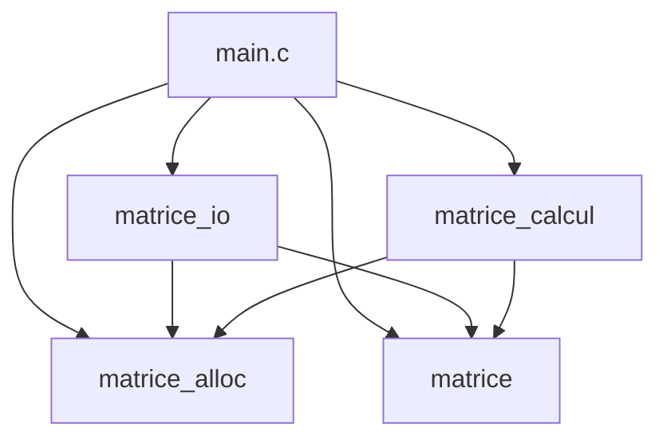
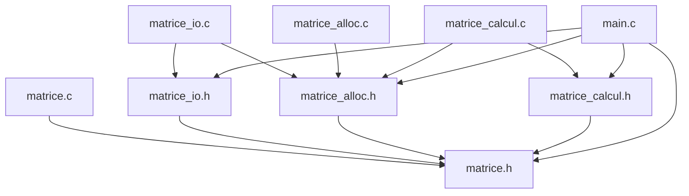

# ALCINOUS-ALAMELOU-td-matrices

## Table des matières
- [1. En-tête](#1-en-tête)
- [2. Introduction](#2-introduction)
- [3. Conception](#3-conception)
- [4. Réalisation](#4-réalisation)
  - [4.1 Exercice 1](#41-exercice-1--allocation-et-destruction)
  - [4.2 Exercice 2](#42-exercice-2--entrées-sorties)
  - [4.3 Exercice 3](#43-exercice-3--calcul-matriciel)
  - [4.4 Exercice 4](#44-exercice-4--démonstration-complète)
- [5. Vérifications mémoire](#5-vérifications-mémoire)
- [6. Démonstration finale](#6-démonstration-finale)
- [7. Bilan et difficultés](#7-bilan-et-difficultés)

---

## 1. En-tête

**Titre du TD :** Stockage de matrices en C

**Membres :**
- Rohan ALAMELOU — `@RohannnA`
- Sandjay ALCINOUS — `@sandjayalcinous`

**Groupe de TD :** 2

## 2. Introduction

Dans ce TD, nous avons écrit une petite bibliothèque en C qui permet de travailler avec des matrices d'entiers. Elle permet de créer une matrice, de la lire depuis un fichier texte, de l'écrire dans un fichier, de l'afficher, et de faire une addition ou une multiplication entre deux matrices.

Le programme `main.c` utilise ces modules suivant (4 modules, chacun avec son fichier `.h` et son fichier `.c`) pour lire deux matrices, faire le calcul demandé, puis afficher et enregistrer le résultat : 

- `matrice` : le type `Matrice`, les codes d'erreur et les fonctions communes
- `matrice_alloc` : la création et la destruction d'une matrice
- `matrice_io` : la lecture, l'écriture et l'affichage
- `matrice_calcul` : l'addition et la multiplication

Les objectifs du TD sont d'apprendre à :
- découper un programme en modules et les compiler séparément
- allouer une matrice dynamiquement avec `calloc` et la libérer sans fuite mémoire, même quand une allocation échoue en cours de route
- lire et écrire dans un fichier en vérifiant chaque opération
- gérer les erreurs de la même façon dans tout le projet, avec un code d'erreur renvoyé par chaque fonction.


## 3. Conception

### Schémas des modules



Rôle de chaque module :

- `matrice` : type Matrice, codes d'erreur MatErreur et outils comme mat_message_erreur et mat_est_valide.
- `matrice_alloc` : création et destruction d'une matrice. Il dépend du type défini dans matrice.h.
- `matrice_io` : lecture, écriture et affichage. Il utilise matrice_alloc pour créer la matrice lue.
- `matrice_calcul` : addition et produit. Il utilise matrice_alloc pour créer le résultat.
- `main.c` : programme de démonstration qui assemble les modules.

### Graphe des inclusions


Chaque .h est protégé par un garde `#ifndef NOM_H` / `#define NOM_H` / `#endif`. Sans lui, main.c, qui inclut matrice.h directement et aussi indirectement via matrice_io.h, matrice_alloc.h et matrice_calcul.h, verrait la définition de struct matrice plusieurs fois, ce qui provoquerait une erreur de compilation. Le garde fait en sorte que le contenu d'un en-tête ne soit traité qu'une seule fois.
Le graphe suit la figure 2 du sujet, chaque fichier inclut que ce qu'il a besoin 

### Règles de propriété de la mémoire

- **Qui alloue ?** `mat_allouer` qui est un module de `matrice_alloc`. mat_lire et les fonctions de calcul passent par elle pour créer une matrice.
- **Qui utilise ?** Les fonctions de `matrice_io` et `matrice_calcul` lisent les matrices reçues sans les modifier.
- **Qui libère ?** Celui qui a reçu la matrice : `main` appelle `mat_detruire` sur a, b et r dans le bloc nettoyage. Une fonction qui échoue libère elle-même ce qu'elle a créé.
- **Que vaut une matrice après un échec ?** Elle vaut `MATRICE_VIDE`

Ci-dessous indique, règle par règle, où le code les respecte.

- **R1** : une matrice est toujours initialisée avant d'être utilisée. Dans `main.c`, a, b et r commencent à MATRICE_VIDE. Dans `matrice_calcul.c`, la variable locale r aussi. Dans `matrice_alloc.c`, mat_allouer remet *res à vide dès le début. Comme ça, détruire une matrice qui n'a jamais été créée ne pose pas de problème.
- **R2** : quand tout s'est bien passé, on fait *res = r; . Le résultat passe alors à l'appelant, c'est lui qui devient responsable de le libérer. C'est à la fin de mat_additionner et mat_multiplier dans `matrice_calcul.c` et de mat_lire dans `matrice_io.c`.
- **R3** : quand il y a une erreur, on libère tout ce qui a été créé avant de quitter la fonction. mat_allouer dans `matrice_alloc.c` libère les lignes déjà allouées. mat_lire dans `matrice_io.c` appelle mat_detruire(&tmp). Les fonctions de calcul qui sont dans `matrice_calcul.c` appellent mat_detruire(&r) avant chaque return d'erreur.
- **R4** : les matrices données en entrée sont des const Matrice *, donc on ne les modifie jamais. C'est le cas dans `matrice_io.c` (écriture, affichage) et dans `matrice_calcul.c`.
- **R5** : verifier_parametres dans `matrice_calcul.c` refuse que le résultat soit la même matrice qu'une entrée. Elle remet aussi *res à vide.
- **R6** : mat_detruire dans `matrice_alloc.c` termine par *m = MATRICE_VIDE;. Si on la détruit une deuxième fois, il ne se passe rien. C'est bien pour le bloc nettoyage de `main.c`, qui détruit r, b et a sans avoir besoin de savoir lesquelles ont été créées.
- **R7** : celui qui ouvre le fichier le ferme. charger et sauvegarder dans `main.c` font fopen et fclose. Il y a aussi mat_lire et mat_ecrire dans `matrice_io.c` ne ferment jamais le fichier.

### Justification des choix

**Ce qui est static, et pourquoi.** verifier_parametres et tient_dans_int dans `matrice_calcul.c` sont static, comme lire_entier, mat_calloc, charger et sauvegarder. 
Ce sont des fonctions qui ne servent que dans leur propre fichier. Les mettre en static car elle permet de les cacher aux autres modules, on ne les met pas dans les .h.

**Gestion de l'échec partiel.** Pour créer une matrice on doit faire plusieurs `malloc` : un pour le tableau de pointeurs et un par ligne. Si il y en a un qui échoue au milieu, il y a déjà des lignes allouées. 
mat_allouer les libère toutes, puis libère le tableau, et renvoie `MAT_ERR_ALLOCATION`. Rien n'est perdu et *res reste vide. 
mat_lire fonctionne de la même façon : elle remplit une matrice temporaire tmp, et la donne à *res que si toute la lecture a réussi. Sinon, elle appelle mat_detruire(&tmp).

**Détection du dépassement d'entier.** Une addition ou un produit de deux int peut dépasser la taille d'un int, et le résultat serait alors faux sans aucun message. 
Pour éviter ça, on fait les calculs dans un long long, qui est plus grand. Ensuite, `tient_dans_int` vérifie que le résultat rentre dans un int. Si ce n'est pas le cas, on libère la matrice et on renvoie MAT_ERR_DEPASSEMENT. 
Dans le produit, on additionne plusieurs termes les uns après les autres. On vérifie donc aussi, avant chaque addition, que la somme ne dépasse pas les limites du `long long` lui-même.

## 4. Réalisation

### 4.1 Exercice 1 — Allocation et destruction

Les fichiers complétés sont matrice.c et matrice_alloc.c.

**Étape 1.a — Messages d'erreur manquants**

```c
case MAT_ERR_DIMENSIONS:  return "dimensions incompatibles pour l'opération";
case MAT_ERR_DEPASSEMENT: return "erreur dépassement de la capacité";
```
Chaque code d'erreur a un message pour informer l'utilisateur de l'erreur en question, et ces messages sont utilisés par `main.c`.

**Étape 1.b — `mat_est_valide`**

```c
return m != NULL
    && m->coef != NULL
    && m->nb_lignes >= 1 && m->nb_lignes <= MAT_DIM_MAX
    && m->nb_colonnes >= 1 && m->nb_colonnes <= MAT_DIM_MAX;
```
Pour tester la validité de la matrice, les conditions utilisées sont dans cet ordre : Si `m` vaut `NULL`, le `&&` s'arrête avant de lire `m->coef`, et sans cela le programme lirait à l'adresse NULL et donc se planterait.

**Étape 1.c — Refuser les dimensions invalides**

```c
if (nb_lignes < 1 || nb_lignes > MAT_DIM_MAX
    || nb_colonnes < 1 || nb_colonnes > MAT_DIM_MAX)
    return MAT_ERR_ARGUMENT;
```
`*res` a déjà été mis à `MATRICE_VIDE` juste avant et l'appelant reçoit donc une matrice vide.

**Étape 1.d — Allouer chaque ligne, en gérant l'échec partiel**

```c
for (int i = 0; i < nb_lignes; i++) {
    coef[i] = mat_calloc((size_t)nb_colonnes, sizeof *coef[i]);
    if (coef[i] == NULL) {
        for (int k = i - 1; k >= 0; k--)   /* lignes déjà obtenues */
            free(coef[k]);
        free(coef);                        /* puis le tableau */
        return MAT_ERR_ALLOCATION;
    }
}
```
Si la ligne `i` échoue, les lignes `0` à `i-1` et le tableau `coef` ont déjà été obtenus. On libère tous avant de renvoyer l'erreur sinon il y aurait une fuite mémoire.

**Étape 1.e — Remplir le résultat**

```c
res->coef = coef;
res->nb_lignes = nb_lignes;
res->nb_colonnes = nb_colonnes;
return MAT_OK;
```
`*res` n'est rempli qu'une fois toutes les allocations réussies donc l'appelant ne reçoit jamais une matrice à moitié construite.

**Étape 1.f — `mat_detruire`**

```c
if (m->coef != NULL) {
    for (int i = 0; i < m->nb_lignes; i++)
        free(m->coef[i]);      /* d'abord chaque ligne */
    free(m->coef);             /* puis le tableau des pointeurs */
}
```
L'ordre est l'inverse de l'allocation : si on libérait `coef` en premier, on ne pourrait plus lire l'adresse des lignes.

#### Questions de réflexion

**Q3.1** — `mat_detruire` doit remettre la matrice de l'appelant à `MATRICE_VIDE` (règle R6), et donc elle a besoin de son adresse. Si on la passait par valeur, la fonction travaillerait sur une copie : la mémoire serait bien libérée, mais seule la copie serait remise à vide. La matrice de l'appelant garderait donc son ancien pointeur vers une zone déjà libérée, et un deuxième `mat_detruire` ferait un double `free`.

**Q3.2** — Pour une matrice n × p, on fait 1 + n appels à `calloc` : un pour le tableau des pointeurs et un pour chaque ligne. On fait donc aussi 1 + n `free` pour la détruire. On le voit avec valgrind sur `test_ex1` : *11 allocs, 11 frees*. Si la k-ième allocation échoue, il faut libérer tout ce qui a été obtenu avant, donc k − 1 blocs (et 0 si c'est la toute première qui échoue).

**Q3.3** — À la fin de `mat_detruire`, la matrice est remise à `MATRICE_VIDE` et donc `coef` vaut `NULL`. Au deuxième appel, le `if (m->coef != NULL)` est faux et on ne libère rien, ce que vérifie le test « un second mat_detruire est sans danger ». Par contre, avec `Matrice b = a;`, on copie seulement le pointeur `coef` et pas les lignes, donc `a` et `b` partagent la même mémoire. Après `mat_detruire(&a)`, `b` pointe encore vers cette mémoire libérée et `mat_detruire(&b)` la libère une deuxième fois : c'est un double `free`.

**Q3.4** — Ici on souhaite que `*res` soit vide dès le début, pour que tous les cas d'erreur qui suivent laissent une matrice vide à l'appelant (règle R3). Ça compte aussi pour l'erreur sur les dimensions de l'étape 1.c. Sinon, si l'appelant n'avait pas initialisé sa variable, elle garderait un pointeur au hasard, et un `mat_detruire` ferait un `free` sur n'importe quelle adresse.

#### Résultat du test

```text
=== Exercice 1 : matrice.c ===
[OK]    (1.a) message pour MAT_ERR_DIMENSIONS
[OK]    (1.a) message pour MAT_ERR_DEPASSEMENT
[OK]    (1.b) une matrice 1 x 2 est valide
[OK]    (1.b) NULL n'est pas valide
[OK]    (1.b) MATRICE_VIDE n'est pas valide
[OK]    (1.b) une matrice de 0 ligne n'est pas valide
=== Exercice 1 : matrice_alloc.c ===
[OK]    (1.c) mat_allouer refuse 0 ligne
[OK]    (1.c) mat_allouer refuse -2 colonnes
[OK]    (1.c) mat_allouer refuse une dimension > MAT_DIM_MAX
[OK]    (1.e) mat_allouer(&m, 3, 4) renvoie MAT_OK
[OK]    (1.e) m a 3 lignes et 4 colonnes
[OK]    (1.d) tous les coefficients valent 0
[OK]    (1.f) apres mat_detruire, m est vide
[OK]    (1.f) un second mat_detruire est sans danger
[OK]    (1.f) mat_detruire(NULL) ne plante pas
=== Exercice 1 : echecs d'allocation simules ===
[OK]    (1.d) chaque echec renvoie MAT_ERR_ALLOCATION et laisse *res vide

Bilan : 16 / 16 verifications reussies.
```

### 4.2 Exercice 2 — Entrées-sorties

Le fichier achevé est matrice_io.c.

**Étape 2.a — Afficher les coefficients**

```c
for (int i = 0; i < m->nb_lignes; i++) {
    for (int j = 0; j < m->nb_colonnes; j++)
        printf(" %8d", m->coef[i][j]);
    putchar('\n');
}
```
Le format `%8d` permet d'afficher chaque coefficient sur 8 caractères pour que les colonnes de la matrice soient alignées.

**Étape 2.b — Écrire au format canonique**

```c
for (int i = 0; i < m->nb_lignes; i++) {
    for (int j = 0; j < m->nb_colonnes; j++) {
        if (fprintf(f, j == 0 ? "%d" : " %d", m->coef[i][j]) < 0)
            return MAT_ERR_ECRITURE;
    }
    if (fputc('\n', f) == EOF)
        return MAT_ERR_ECRITURE;
}
```
On souhaite que le premier coefficient d’une ligne s’écrive sans espace devant et les suivants avec un espace. On obtient donc un seul espace entre deux nombres et aucun en fin de ligne. Chaque écriture est vérifiée si fprintf renvoie un nombre négatif, ou si fputc (le saut de ligne avec \n) renvoie EOF, on renvoie MAT_ERR_ECRITURE.

**Étape 2.c — Vérifier les dimensions lues**

```c
if (nb_lignes < 1 || nb_lignes > MAT_DIM_MAX
    || nb_colonnes < 1 || nb_colonnes > MAT_DIM_MAX)
    return MAT_ERR_FORMAT;
```
On vérifie les dimensions lues dans le fichier et on renvoie MAT_ERR_FORMAT si elles sont hors de l’intervalle autorisé, car c'est le contenu du fichier que l'on souhaite vérifier.

**Étape 2.d — Réserver une matrice locale**

```c
Matrice tmp;
err = mat_allouer(&tmp, nb_lignes, nb_colonnes);
if (err != MAT_OK)
    return err;
```
On alloue une matrice locale tmp que l’on remplit à la place de *res et si une erreur survient au milieu du fichier, l’appelant ne recevra donc jamais une matrice à moitié remplie.

**Étape 2.e — Lire chaque coefficient**

```c
for (int i = 0; i < nb_lignes; i++) {
    for (int j = 0; j < nb_colonnes; j++) {
        err = lire_entier(f, &tmp.coef[i][j]);
        if (err != MAT_OK) {
            mat_detruire(&tmp);
            return err;
        }
    }
}
```
Et en cas d'erreur, cette matrice locale `tmp` est détruite avant de renvoyer le code, il n'y a donc aucune fuite et `*res` reste vide.

**Étape 2.f — Transférer le résultat**

```c
*res = tmp;
return MAT_OK;
```
À partir de là, l'appelant possède la matrice locale que l'on a créée et devra la détruire conformément à la règle R2.

#### Questions de réflexion

**Q4.1** — Si on lisait directement dans `*res` et qu'une erreur arrivait au milieu du fichier, l'appelant recevrait une matrice à moitié remplie. En passant par la matrice locale `tmp`, on peut la détruire en cas d'erreur et `*res` reste donc vide (règle R3). On donne la matrice à l'appelant seulement une fois toute la lecture réussie. Valgrind sur `test_ex2` montre qu'il n'y a aucune fuite, même avec les fichiers incorrects (*51 allocs, 51 frees*).

**Q4.2** — Non, la lecture ne vérifie pas que chaque ligne de la matrice est sur sa propre ligne, car `fscanf` saute tous les espaces et les sauts de ligne. Ce n'est pas gênant car les dimensions au début du fichier disent combien de nombres il faut lire, et donc la mise en page ne change pas le résultat. Être tolérant en lecture permet d'accepter un fichier modifié à la main avec des espaces en trop, et être strict en écriture permet d'avoir des fichiers toujours écrits de la même façon.

**Q4.3** — Comme `mat_lire` ne ferme pas le fichier et s'arrête juste après le dernier coefficient, on peut écrire deux matrices à la suite dans le même fichier. Ensuite, on ouvre le fichier une seule fois et on appelle `mat_lire` deux fois : le premier appel lit la première matrice, et le deuxième reprend là où le premier s'est arrêté pour lire la deuxième.

**Q4.4** — `fprintf` n'écrit pas tout de suite dans le fichier, car les données passent d'abord par un tampon en mémoire. `fflush` force l'écriture, ce qui permet de détecter une erreur (par exemple un disque plein) directement dans `mat_ecrire`. Mais ça ne dispense pas l'appelant de tester `fclose`, car la fermeture peut aussi échouer. C'est pour ça que la fonction `sauvegarder` de `main.c` teste `fclose(f) == EOF`.

#### Résultat du test

```text
=== Exercice 2 : affichage (verification visuelle) ===
M (4 x 3) :
       1       2       3
       4       5       6
       7       8       9
      10      11      12
=== Exercice 2 : ecriture ===
[OK]    ouverture de test_ex2_sortie.txt en ecriture
[OK]    (2.b) mat_ecrire renvoie MAT_OK
[OK]    (2.b) le fichier contient exactement le format attendu
[OK]    (2.b) mat_ecrire refuse une matrice vide
=== Exercice 2 : relecture ===
[OK]    (2.f) mat_lire relit le fichier : MAT_OK
[OK]    (2.e) la matrice relue est identique
[OK]    (2.e) espaces et sauts de ligne en trop sont toleres
=== Exercice 2 : fichiers incorrects ===
[OK]    (2.c) fichier vide
[OK]    (2.c) dimension nulle
[OK]    (2.c) dimension negative
[OK]    (2.e) coefficient manquant
[OK]    (2.e) donnee non numerique
[OK]    (2.e) entier trop grand pour un int
=== Exercice 2 : echec d'allocation simule ===
[OK]    (2.d) mat_lire renvoie MAT_ERR_ALLOCATION proprement

Bilan : 14 / 14 verifications reussies.
```

### 4.3 Exercice 3 — Calcul matriciel

**Étape 3.a — Addition : Contrôler les dimensions**

```c
if (a->nb_lignes != b->nb_lignes || a->nb_colonnes != b->nb_colonnes)
        return MAT_ERR_DIMENSIONS;
```
L'addition est possible que si les deux matrices ont les
mêmes dimensions.

**Étape 3.b — Addition : Réserver le résultat**

```c
err = mat_allouer(&r, a->nb_lignes, a->nb_colonnes);
if (err != MAT_OK)
        return err;
```
On réutilise `mat_allouer` (exercice 1) pour créer le résultat avec les
dimensions de la matrice `a`.


**Étape 3.c — Addition : Calculer chaque coefficient**

```c
long long s = (long long)a->coef[i][j] + b->coef[i][j];
```

Le calcul se fait en `long long` pour détecter un  dépassement
avant qu'il se fasse  en `int`.

**Étape 3.d — Addition : Transférer le résultat**

```c
*res = r;
return MAT_OK;
```
transfère la propriété de la matrice calculée à l’appelant, puis on renvoie MAT_OK

**Étape 3.e — Multiplication : Contrôler les dimensions (produit)**

```c
if (a->nb_colonnes != b->nb_lignes)
        return MAT_ERR_DIMENSIONS;
```
Le produit de  a et b est possible que si le nombre de colonnes de a est égal au nombre de lignes de b.

**Étape 3.f — Multiplication : Réserver le résultat**

```c
err = mat_allouer(&r, a->nb_lignes, b->nb_colonnes);
if (err != MAT_OK)
        return err;
```
Le résultat a a->nb_lignes lignes et b->nb_colonnes colonnes, c’est un mélange des dimensions des deux matrices d’entrée

**Étape 3.g — Multiplication : La somme des produits**

```c
for (int k = 0; k < a->nb_colonnes; k++) {
        long long p = (long long)a->coef[i][k] * b->coef[k][j];
        if ((p > 0 && s > LLONG_MAX - p)
            || (p < 0 && s < LLONG_MIN - p)) {
                mat_detruire(&r);
                return MAT_ERR_DEPASSEMENT;
        }
        s += p;
}

```
Ici un coefficient est la somme des produits d’une ligne de a par une colonne de b. Avant chaque addition à s, on vérifie qu’elle ne dépasse pas les bornes d’un long long, et on détruit r avant de renvoyer l’erreur pour éviter une fuite.

**Étape 3.h — Multiplication : Transférer le résultat**

```c
*res = r;
return MAT_OK;
```
Identique à l'étape 3.d pour l'addition.

#### Résultats tests

```text
gcc -std=c11 -Wall -Wextra -Wpedantic -g -DMAT_TEST_ALLOC \
    test_ex3.c matrice.c matrice_alloc.c matrice_calcul.c -o test_ex3
./test_ex3
=== Exercice 3 : addition ===
[OK]    (3.a) (2 x 3) + (3 x 2) : MAT_ERR_DIMENSIONS
[OK]    (3.d) (2 x 3) + (2 x 3) : MAT_OK
[OK]    (3.c) a + b est correct
[OKé]    a et b n'ont pas ete modifiees
[OK]    (3.b) le resultat possede sa propre memoire
[OK]    (3.c) INT_MAX + 1 : MAT_ERR_DEPASSEMENT
=== Exercice 3 : multiplication ===
[OK]    (3.e) (2 x 3) x (2 x 3) : MAT_ERR_DIMENSIONS
[OK]    (3.h) (2 x 3) x (3 x 2) : MAT_OK
[OK]    (3.g) a x c = (58 64 / 139 154)
[OK]    (3.f) (3 x 2) x (2 x 3) donne une matrice 3 x 3
[OK]    a et c n'ont pas ete modifiees
[OK]    (3.g) 2 x 10^10 depasse INT_MAX : MAT_ERR_DEPASSEMENT
=== Exercice 3 : cas particuliers ===
[OK]    resultat = entree refuse, a reste intacte
[OK]    (3.f) echec d'allocation : MAT_ERR_ALLOCATION, r vide

Bilan : 14 / 14 verifications reussies.
Pensez a verifier l'absence de fuite : valgrind --leak-check=full ./test_ex3
```
**Questions de réflexion**

**Q5.1.** Non, const Matrice *a n'empêche pas d'écrire `a->coef[0][0] = 7;`. Le const protège la structure elle-même. Mais `coef` est un pointeur, et les coefficients sont dans des tableaux alloués avec `malloc`, ailleurs en mémoire. Le `const` ne va pas jusque-là. Pour que le compilateur refuse l'affectation, il faudrait déclarer le champ "const int *const *coef;" dans la structure et donc modifier le fichier .h, ce qui oblige à modifier `matrice.h`.

**Q5.2.** verifier_parametres commence par `*res = MATRICE_VIDE;`. Si res était a, on viderait a avant de la lire : ses données seraient perdues et ses blocs mémoire jamais libérés fuite. Le calcul crée de toute façon une nouvelle matrice, donc le résultat doit aller dans une matrice distincte.

**Q5.3.** `mat_multiplier` a trois boucles imbriquées : i (de 0 à n), j (de 0 à q) et k (de 0 à p). Pour une matrice n × p par une matrice p × q, elle fait donc n × p × q multiplications. Pour deux matrices 1000 × 1000, cela fait 1000 × 1000 × 1000 = 10 puissance 9 multiplications donc 1 milliard

**Q5.4.** Parce que `int s = a + b;` peut déjà déborder, et qu'un dépassement sur un int signé est un comportement indéfini en C. Le compilateur a le droit de supposer qu'il n'arrive jamais, donc il peut supprimer le test s < a. Nous avons choisi de faire le calcul dans un `long long`, qui est plus grand, puis de vérifier avec `tient_dans_int` que le résultat rentre dans un `int`.


### 4.4 Exercice 4 — Démonstration complète

**Étape 4.a — Afficher A et B**

```c
mat_afficher("A", &a);
mat_afficher("B", &b);
```
Affichage de mise au point des deux matrices chargées, avant le calcul

**Étape 4.b — Calculer le résultat**

```c
MatErreur err = addition ? mat_additionner(&a, &b, &r)
                          : mat_multiplier(&a, &b, &r);
if (err != MAT_OK) {
        fprintf(stderr, "Erreur : calcul impossible : %s ",
                mat_message_erreur(err));
        fprintf(stderr, "(A : %d x %d, B : %d x %d)\n",  a.nb_lignes, a.nb_colonnes, b.nb_lignes, b.nb_colonnes);
        goto nettoyage;
}
```
L’opérateur choisit l’addition ou la multiplication selon l’argument. En cas d’erreur, le message avec stderr affiche la cause et les dimensions de A et B, ensuite goto nettoyage mène à la sortie

**Étape 4.c — Afficher le résultat**

```c
mat_afficher(addition ? "R = A + B" : "R = A x B", &r);
```
Affichage du résultat, avec un nom qui dépend de l’opération

**Étape 4.d — Signaler le succès**

```c
printf("Résultat enregistré dans \"%s\".\n", argv[4]);
statut = EXIT_SUCCESS;
```
Cette ligne sera atteinte que si tout a réussi, c’est le seul moment où statut passe à EXIT_SUCCESS, tous les échecs passe par goto nettoyage avant

**Questions de réflexion**

**Q6.1.** `mat_lire` fait partie d'une bibliothèque réutilisable. Si elle affichait elle-même l'erreur dans le terminal, un programme graphique ne pourrait pas choisir comment l'afficher. Elle renvoie donc un code `MatErreur`, et c'est `main.c` qui décide du message.

**Q6.2.** En écriture, les données sont dans un tampon et ne sont vraiment écrites qu'au `fclose` : une erreur cet à dire quand le dique est plein peut n'apparaître qu'à ce moment. En lecture, tout a déjà été lu et vérifié avant `fclose`, donc un échec ne fait rien perdre.

**Q6.3.** Trois matrices : `a`, `b` et `r`, car le calcul a réussi. L'échec de l'enregistrement fait sauter à `nettoyage`, qui appelle `mat_detruire` sur chacune. Valgrind le confirme sur le scenario 8 :

```text

      10      11      12
R = A + B (4 x 3) :
      26      50      87
      19      38      17
      52      96      19
      10      23       7
==259029== 
==259029== HEAP SUMMARY:
==259029==     in use at exit: 0 bytes in 0 blocks
==259029==   total heap usage: 23 allocs, 23 frees, 13,966 bytes allocated
==259029== 
==259029== All heap blocks were freed -- no leaks are possible
==259029== 
==259029== For lists of detected and suppressed errors, rerun with: -s
==259029== ERROR SUMMARY: 0 errors from 0 contexts (suppressed: 0 from 0)


```

## 5. Vérifications mémoire

Chaque programme a été lancé avec valgrind --leak-check=full.

### test_ex1
```text
==10327== HEAP SUMMARY:
==10327==     in use at exit: 0 bytes in 0 blocks
==10327==   total heap usage: 11 allocs, 11 frees, 1,228 bytes allocated
==10327==
==10327== All heap blocks were freed -- no leaks are possible
==10327== ERROR SUMMARY: 0 errors from 0 contexts (suppressed: 0 from 0)
```

### test_ex2
```text
==23213== HEAP SUMMARY:
==23213==     in use at exit: 0 bytes in 0 blocks
==23213==   total heap usage: 51 allocs, 51 frees, 60,728 bytes allocated
==23213==
==23213== All heap blocks were freed -- no leaks are possible
==23213== ERROR SUMMARY: 0 errors from 0 contexts (suppressed: 0 from 0)
```

### test_ex3
```text
==29627==
==29627== HEAP SUMMARY:
==29627==     in use at exit: 0 bytes in 0 blocks
==29627==   total heap usage: 37 allocs, 37 frees, 4,484 bytes allocated
==29627==
==29627== All heap blocks were freed -- no leaks are possible
==29627==
==29627== For lists of detected and suppressed errors, rerun with: -s
==29627== ERROR SUMMARY: 0 errors from 0 contexts (suppressed: 0 from 0)
```

### demo_matrices — cas réussi (scénario 1 : addition de A et B)
```text
==30963== HEAP SUMMARY:
==30963==     in use at exit: 0 bytes in 0 blocks
==30963==   total heap usage: 22 allocs, 22 frees, 14,968 bytes allocated
==30963==
==30963== All heap blocks were freed -- no leaks are possible
==30963== ERROR SUMMARY: 0 errors from 0 contexts (suppressed: 0 from 0)
```

### demo_matrices — scénario d'erreur (scénario 8 : dossier de sortie inexistant)
```text
$ valgrind --leak-check=full ./demo_matrices add donnees/A.txt donnees/B.txt dossier_inexistant/R.txt
...
Erreur : impossible de créer "dossier_inexistant/R.txt" : No such file or directory
==35694== HEAP SUMMARY:
==35694==     in use at exit: 0 bytes in 0 blocks
==35694==   total heap usage: 23 allocs, 23 frees, 10,894 bytes allocated
==35694==
==35694== All heap blocks were freed -- no leaks are possible
==35694== ERROR SUMMARY: 0 errors from 0 contexts (suppressed: 0 from 0)
```

## 6. Démonstration finale

Quatre scénarios : deux réussites (1 et 2) et deux erreurs (3 et 8).

### Scénario 1 : addition valide

```text
$ ./demo_matrices add donnees/A.txt donnees/B.txt R.txt
A (4 x 3) :
      25      48      84
      15      33      11
      45      88      10
       0      12      -5
B (4 x 3) :
       1       2       3
       4       5       6
       7       8       9
      10      11      12
R = A + B (4 x 3) :
      26      50      87
      19      38      17
      52      96      19
      10      23       7
Résultat enregistré dans "R.txt".
$ echo $?
0
```

Attendu : `A`, `B` et `R` sont affichées, `R.txt` est créé, code de retour 0.

### Scénario 2 : produit valide

```text
$ ./demo_matrices mul donnees/A.txt donnees/C.txt R.txt
A (4 x 3) :
      25      48      84
      15      33      11
      45      88      10
       0      12      -5
B (3 x 2) :
       1       0
       0       1
       2      -1
R = A x B (4 x 2) :
     193     -36
      37      22
      65      78
     -10      17
Résultat enregistré dans "R.txt".
$ echo $?
0
```

Attendu : `A` (4 x 3) par `C` (3 x 2) donne une matrice 4 x 2, code de retour 0.

### Scénario 3 (erreur) : dimensions incompatibles

```text
$ rm -f R.txt
$ ./demo_matrices add donnees/A.txt donnees/C.txt R.txt
A (4 x 3) :
      25      48      84
      15      33      11
      45      88      10
       0      12      -5
B (3 x 2) :
       1       0
       0       1
       2      -1
Erreur : calcul impossible : dimensions incompatibles (A : 4 x 3, B : 3 x 2)
$ echo $?
1
$ ls R.txt
ls: impossible d'accéder à 'R.txt': Aucun fichier ou dossier de ce nom
```

Attendu : l'addition est refusée car 4 x 3 et 3 x 2 sont différentes. Le message donne la cause et les dimensions, aucun fichier n'est créé, code de retour 1.

### Scénario 8 (erreur) : enregistrement impossible

```text
$ ./demo_matrices add donnees/A.txt donnees/B.txt dossier_inexistant/R.txt
A (4 x 3) :
      25      48      84
      15      33      11
      45      88      10
       0      12      -5
B (4 x 3) :
       1       2       3
       4       5       6
       7       8       9
      10      11      12
R = A + B (4 x 3) :
      26      50      87
      19      38      17
      52      96      19
      10      23       7
Erreur : impossible de créer "dossier_inexistant/R.txt" : No such file or directory
$ echo $?
1
```

Attendu : le calcul réussit mais le fichier ne peut pas être créé. Le message donne le nom du fichier et la cause du système, les trois matrices sont libérées comme répondu à la question 6.3, code de retour 1.

## 7. Bilan et difficultés

Grâce à ce TD, nous avons compris comment représenter une matrice de taille variable avec un tableau de pointeurs, où chaque ligne est allouée à part. Nous avons surtout appris à gérer la mémoire sans fuite, en sachant qui alloue, qui possède le résultat et qui libère. Nous avons aussi compris l'intérêt de découper le code en modules, et de vérifier chaque opération (allocation, lecture, écriture) en renvoyant un code d'erreur.

**Difficultés rencontrées et comment on les a résolues :**

- **Erreur de boucle dans `matrice_io.c` :** dans les boucles de 2.a et 2.b, nous  avions écrit `i++` au lieu de `j++` dans la boucle intérieure, et le programme plantait (Segmentation fault). Valgrind nous a donné la ligne exacte (matrice_io.c:53) et nous a montré que le programme lisait juste après la fin du tableau des lignes, donc `coef[4]` qui n'existe pas.

- **Dimension nulle refusée avec le mauvais code :** en 2.c, nous avions écrit < 0 au lieu de < 1. La dimension 0 passait donc le contrôle, et c'est `mat_allouer` qui la refusait avec `MAT_ERR_ARGUMENT` au lieu de `MAT_ERR_FORMAT`. Le test "dimension nulle" échouait (13/14) et on a corrigé la condition.

- **Mise en place de l'environnement :** Un d'entre nous a installer WSL (Ubuntu sous Windows) pour avoir gcc et valgrind. Et a dû s'adapter à cet environnement nouveau.


**Répartition du travail :**

- **Sandjay ALCINOUS :** exercices 1 et 2 (`matrice.c`, `matrice_alloc.c`, `matrice_io.c`), vérifications mémoire avec valgrind, et rédaction des parties 1, 2, 4.1, 4.2, 5 et 7 du compte rendu.

- **Rohan ALAMELOU :** exercices 3 et 4 (`matrice_calcul.c`, `main.c`), et rédaction des parties 3 (conception), 4.3, 4.4, 6 (démonstration finale) et une partie du 7 du compte rendu.

**Aides extérieures :** Nous avons utilisé un outil d'IA pour :
- mettre en place l'environnement (WSL, Git, GitHub, tag de rendu)
- nous aider à comprendre les messages du compilateur et de valgrind pendant le débogage
- proposer un modèle de markdown et le Makefile
- correction de formulation dans parties du compte rendu.

## Annexes (facultatif)

